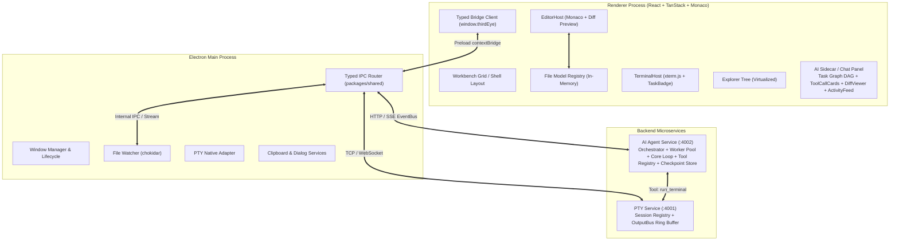

# THIRD_EYE Architecture Specification

## 1. System Overview
THIRD_EYE is an industry-grade, autonomous multi-agent coding system and AI-native Integrated Development Environment (IDE) architected with a decoupled 4-process topology. Inspired by Cursor Agent mode and Google Antigravity, it unifies high-performance terminal multiplexing, Monaco editor workflows, file system virtualization, and an autonomous Orchestrator-Worker multi-agent hierarchy.



---

## 2. Process Architecture

| Process | Runtime | Primary Responsibilities | Network / IPC Boundaries |
| :--- | :--- | :--- | :--- |
| **Electron Main** | Node.js (Electron 29) | Native OS windowing, file watcher, native dialogs, IPC routing | Preload bridge `window.thirdEye` |
| **Renderer** | React 18 / Vite / TanStack | Workbench layout, Monaco editor, in-memory file models, xterm.js terminals, Task Graph DAG viewer, DiffViewer, Permission cards | `window.thirdEye` typed contract |
| **PTY Service** | Node.js (:4001) | `node-pty` process orchestration, 10,000-line circular ring buffer (`outputBus`), shell integration (OSC parsing) | WebSocket `/pty/stream` + REST |
| **AI Agent Service** | Node.js (:4002) | Multi-Agent Orchestrator, Worker Pool (max 3 concurrent), Core Loop, 30 Zod-validated tools, Budgeted Context Envelope, Checkpoint Store | HTTP REST + SSE streaming |

---

## 3. The Contract Layer (`packages/shared`)
All inter-process communication is governed by typed schemas in `@third-eye/shared`:
- `agent.ts`: `TaskGraphStep`, `TaskGraphDAG`, `TaskStepStatus`, `WorkerRole`, `AgentSpec`, `FileLockInfo`, and unified turn models.
- `events.ts`: Typed real-time SSE stream events (`agent.delta`, `tool.start`, `tool.end`, `agent.status`, `task.graph`, `task.update`, `checkpoint.created`, `permission.request`, `agent.done`, `agent.stuck`).
- `tools.ts`: Zod-validated tool definitions, risk categorizations (`read`, `write`, `exec`, `network`), timeouts, and permissions.
- `permissions.ts`: Decision engine policies (`allow_once`, `allow_session`, `reject`, and auto-allow patterns).
- `ipc.ts`: Channel constants and typed Request/Response signatures for Electron main bridge.

---

## 4. Orchestrator-Worker Multi-Agent Topology

The backend AI service implements an autonomous Orchestrator-Worker hierarchy:

```
user prompt
    │
    ▼
┌──────────────┐   Task Graph DAG   ┌──────────────┐
│ ORCHESTRATOR │ ─────────────────► │ WORKER POOL  │  (max 3 concurrent)
│ (planner +   │ ◄───────────────── │  - Coder     │
│  supervisor) │   progress/results │  - Debugger  │
└──────────────┘                    │  - Tester    │
       │                            │  - Researcher│
       ▼                            └──────────────┘
Verification Gate (build + tests + preview) ──► Complete or Self-Heal Retry
```

### 4.1 Orchestrator Intelligence
1. **Dynamic DAG Planning**: Given a user prompt, the Orchestrator uses the LLM to generate an acyclic dependency graph of atomic steps (`TaskGraphStep[]`), with fallback to an intelligent heuristic DAG.
2. **Topological Worker Scheduling**: Independent steps execute concurrently across the Worker Pool (up to 3 concurrent workers).
3. **Self-Healing & Supervisor Hotfix**: If a worker fails, the step is retried with error context up to 2 times. On repeated failures, the Orchestrator Supervisor takes over with full diagnostic context or splits the step.
4. **Verification Pass Gate**: Completion is never declared on the model's word alone. The system executes a verification suite (compiles build, runs tests, checks compiler diagnostics, starts dev server in background, and verifies preview response) before marking the task complete.

### 4.2 Specialized Agent Roles
- **Orchestrator** (`orchestrator.md`): Project manager. Decomposes tasks, assigns workers, verifies evidence, replans on blockers.
- **Coder** (`coder.md`): Inspects files, applies minimal verifiable edits with snapshots and file locks, verifies build.
- **Debugger** (`debugger.md`): Ingests terminal stack traces, diagnostics, and failing tests. Performs minimal root-cause fixes.
- **Tester** (`tester.md`): Authors test suites, executes runners via terminal tools, reports coverage and assertion failures.
- **Researcher** (`researcher.md`): Queries codebases, AST symbols, docs, and web sources. Never mutates workspace code.

---

## 5. The Core Agent Loop (`core/loop.ts`)
A single, universal loop used by both the Orchestrator and all workers:
1. **Context Envelope**: Assembles prompt within strict token budgets (System 15%, Task+Graph 15%, RepoMap+Chunks 35%, History 25%, Terminal tails 10%). Compacts conversation turns and trims tails on budget overflow.
2. **Streaming Tokens**: LLM streaming deltas are forwarded live via `agent.delta` events.
3. **Tool Execution & Safety Sandboxing**:
   - Every tool call is Zod-validated.
   - Mutating tools acquire exclusive file locks (`FileLockRegistry`) and trigger pre-mutation snapshots (`CheckpointManager`).
   - Terminal & network tools evaluate permission policies (`permissionPolicy`).
   - Every tool output is treated as an observation for self-correction.
4. **Session Auditing**: Complete conversation and tool logs are written to `.third-eye/sessions/<timestamp>.jsonl`.

---

## 6. Tool Registry & Safety Subsystems (`tools/`)
The tool registry registers 30+ specialized tools across 4 risk tiers:
- **Read Tools** (`read`): `read_file`, `list_dir`, `search_code` (ripgrep), `search_symbols` (AST parser), `read_file_lines`, `get_diagnostics`, `git_status`, `git_diff`.
- **Write Tools** (`write`): `write_file`, `edit_file` (exact match with fuzzy fallback), `apply_patch` (unified diff), `delete_file`, `create_dir`, `move_file`.
- **Terminal Tools** (`exec`): `run_terminal` (sync & background tasks), `read_task_output` (live tail from pty outputBus), `list_tasks`, `kill_task`, `wait_for_pattern` (regex readiness).
- **Research Tools** (`network`): `web_search`, `fetch_url` (markdown extractor), `fetch_docs` (cached documentation).
- **Browser/Preview Tools** (`exec`): `open_preview`, `browser_eval`, `take_screenshot`.
- **Analysis Tools**: `analyze_codebase` (repo map), `plan_check`.

---

## 7. The Watching Experience in AI Sidecar UI
The frontend renders a comprehensive, real-time interface consuming the live SSE event stream:
- **TaskGraphDAGViewer**: Collapsible DAG tree with status badges (`pending`, `running`, `done`, `failed`), worker hints, and retry badges.
- **ToolCallCard**: Live tool cards colored by risk (`read`=gray, `write`=amber, `exec`=red, `network`=purple) with expandable arguments and raw outputs.
- **DiffViewerModal**: Inline Monaco diff editor with per-file `Accept`, `Reject`, and `Accept All` buttons.
- **PermissionPromptCard**: Sticky elevation prompt with single-action and batch allowance (`Allow All This Session`), with idle alert after 60 seconds.
- **ActivityFeedModal**: Chronological merged stream of all agent reasoning, tool invocations, terminal outputs, and checkpoints.
- **TaskBadge**: Pulsing indicator on terminal tabs showing count of running agent background tasks.
- **Emergency STOP Kill Switch**: Cancels all agent streams, terminates agent-owned PTY processes, and preserves checkpoints.
- **Checkpoint Undo & Revert**: Dedicated buttons for reverting the last agent mutation or rolling back the entire session.
